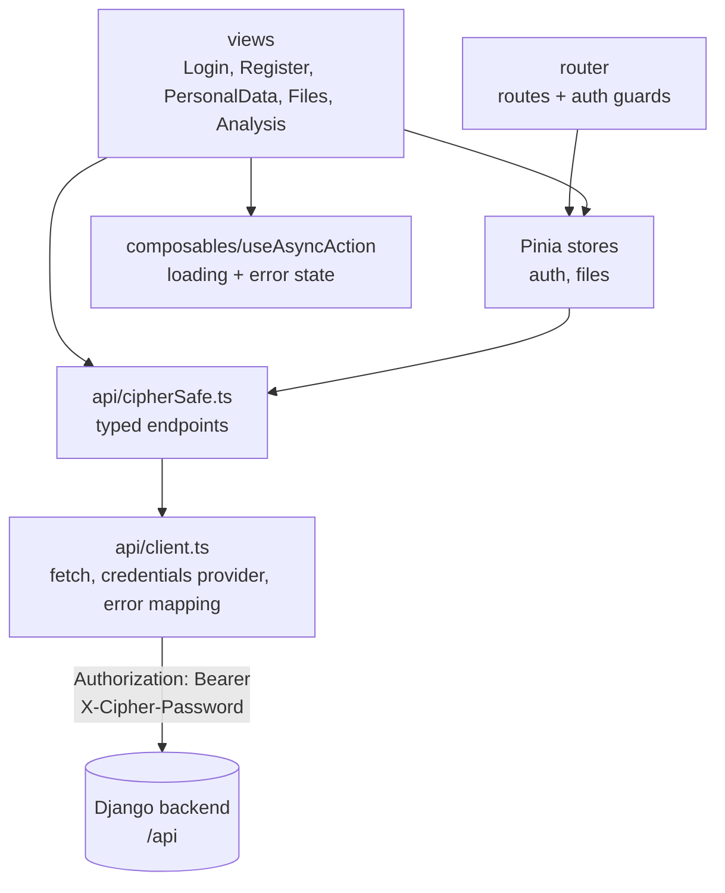

# Cipher Safe Frontend

Vue 3 + TypeScript SPA for **Cipher Safe**, a **patient-held medical records
vault**. It talks to the Django backend (`cipher-safe-backend`) and lets a
patient keep their own records between clinics and hospitals: a patient
profile (identity + health details), KTP / BPJS card scans, medical documents
(lab results, referral letters, medication logs) and medical videos
(ultrasound, echo, endoscopy), all encrypted with **AES, DES and RC4** and
integrity-checked with HMAC-SHA256.

## Features

- **Sign up / sign in**: the backend issues JWT access + refresh tokens; the same
  password is also the source of every encryption key.
- **Patient profile**: read/write identity and health fields (health fields
  are flagged as UU PDP Art. 4(2) / GDPR Art. 9 data); each save stores three
  ciphertexts (AES, DES, RC4).
- **Records**: upload a card scan / medical document / medical video, then
  download it back decrypted with any of the three algorithms. The server
  uses CTR for AES and DES; a tampered file is refused rather than returned.
- **Analysis**: per-algorithm timing tables (encryption + downloads), a
  per-file benchmark, and download history.

## Architecture



## Security model

The password is needed on every crypto request, so it - along with the access and
refresh tokens - is held **in memory only** in the Pinia auth store; nothing is
written to `localStorage`/`sessionStorage`. Reloading the page therefore signs
the user out. Requests carry:

- `Authorization: Bearer <access>`
- `X-Cipher-Password: <password>`

When the short-lived access token expires, the client refreshes it once with the
stored refresh token and retries the request, so the user is not interrupted.

## Setup

Requires Node `^22.18 || >=24.12` and the backend running on
`http://127.0.0.1:8000`.

```bash
npm install
npm run dev          # http://localhost:5173
```

During development, Vite proxies `/api` to the backend (see `vite.config.ts`),
so no CORS configuration is needed. Override the target with `VITE_PROXY_TARGET`
or point at a different backend for a build with `VITE_API_BASE`.

```bash
# .env (both optional)
VITE_PROXY_TARGET=http://127.0.0.1:8000
VITE_API_BASE=            # empty = use the dev proxy / same-origin /api
```

## Scripts

| Command | Purpose |
| --- | --- |
| `npm run dev` | Dev server with hot reload + API proxy |
| `npm run build` | Type-check and production build into `dist/` |
| `npm run type-check` | `vue-tsc` only |
| `npm run test:unit` | Vitest unit tests |
| `npm run test:e2e` | Playwright smoke tests |
| `npm run lint` | oxlint + ESLint (auto-fix) |
| `npm run format` | Prettier |

## Layout

```
src/
  api/          fetch client + typed endpoint wrappers
  assets/       global styles
  composables/  useAsyncAction (loading/error wrapper)
  router/       routes + auth guards
  stores/       Pinia stores (auth, files)
  types/        API types mirroring the DRF serializers
  utils/        formatting + download helpers
  views/        Login, Register, PersonalData, Files, Analysis
  __tests__/    unit tests
e2e/            Playwright tests
```

## Known issue

`npm audit` reports high-severity advisories in `braces` (via
`@vue/eslint-config-typescript` -> `fast-glob` -> `micromatch`). `braces@3.0.3`
is the latest release and has no patched version, and it is only used by the
lint tooling; it is not part of the production bundle.
