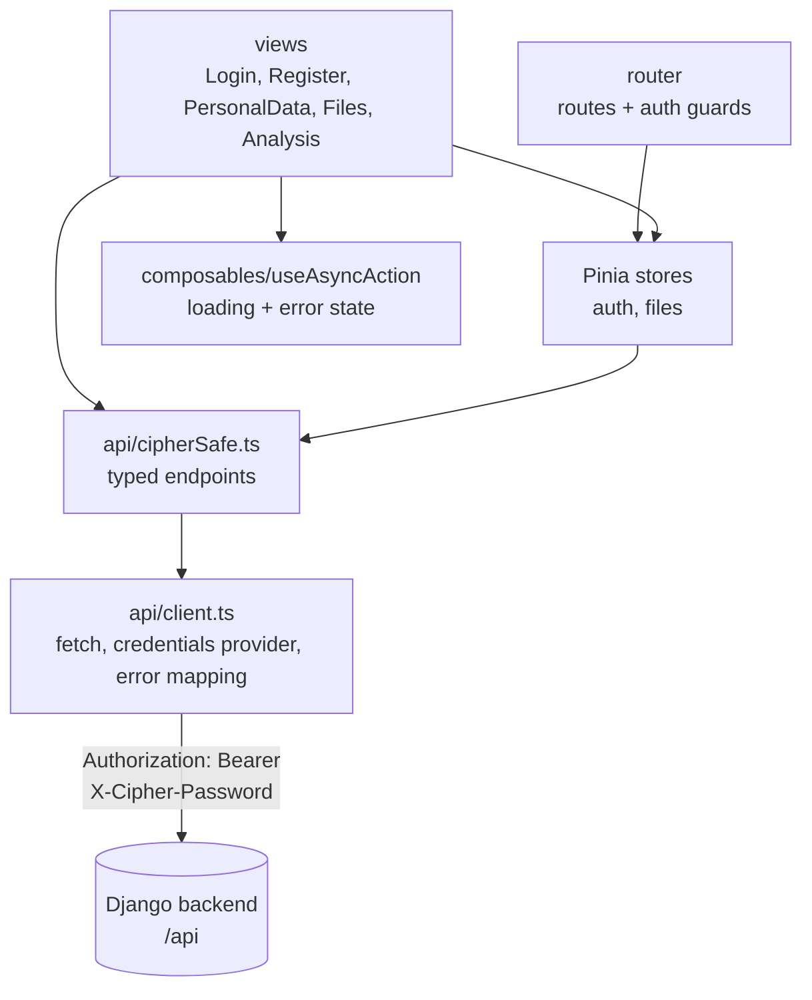

# Cipher Safe Frontend

Vue 3 + TypeScript SPA for **Cipher Safe**, a **patient-held medical records
vault**. It talks to the Django backend (`cipher-safe-backend`) and lets a
patient keep their own records between clinics and hospitals: a patient
profile (identity + health details), KTP / BPJS card scans, medical documents
(lab results, referral letters, medication logs) and medical videos
(ultrasound, echo, endoscopy), all encrypted with **AES, DES and RC4** and
integrity-checked with HMAC-SHA256.

## Features

- **Sign up / sign in**: the backend issues JWT access + refresh tokens; the same
  password is also the source of every encryption key.
- **Patient profile**: read/write identity and health fields (health fields
  are flagged as UU PDP Art. 4(2) / GDPR Art. 9 data); each save stores three
  ciphertexts (AES, DES, RC4).
- **Records**: upload a card scan / medical document / medical video, then
  download it back decrypted with any of the three algorithms. The server
  uses CTR for AES and DES; a tampered file is refused rather than returned.
- **Analysis**: per-algorithm timing tables (encryption + downloads), a
  per-file benchmark, and download history.

## Architecture



## Security model

The password is needed on every crypto request, so it - along with the access and
refresh tokens - is held **in memory only** in the Pinia auth store; nothing is
written to `localStorage`/`sessionStorage`. Reloading the page therefore signs
the user out. Requests carry:

- `Authorization: Bearer <access>`
- `X-Cipher-Password: <password>`

When the short-lived access token expires, the client refreshes it once with the
stored refresh token and retries the request, so the user is not interrupted.

## Setup

### 1. Install the tools

- **Node** `^22.18 || >=24.12`
- **pnpm**: `npm install -g pnpm`. The exact pnpm version is pinned in
  `package.json` (`packageManager`), and pnpm switches to it automatically.
- **The backend** running on `http://127.0.0.1:8000`; see the
  `cipher-safe-backend` README (`docker compose up`).

### 2. Install and run

```bash
pnpm install         # installs exactly what pnpm-lock.yaml lists
pnpm dev             # http://localhost:5173
```

For the end-to-end tests, download the browsers once:

```bash
pnpm exec playwright install
```

### 3. Optional: `.env`

Nothing has to be generated for the frontend; it has no secrets.

During development, Vite proxies `/api` to the backend (see `vite.config.ts`),
so no CORS configuration is needed. Override the target with `VITE_PROXY_TARGET`
or point at a different backend for a build with `VITE_API_BASE`.

```bash
# .env (both optional)
VITE_PROXY_TARGET=http://127.0.0.1:8000
VITE_API_BASE=            # empty = use the dev proxy / same-origin /api
```

## Scripts

| Command | Purpose |
| --- | --- |
| `pnpm dev` | Dev server with hot reload + API proxy |
| `pnpm build` | Type-check and production build into `dist/` |
| `pnpm type-check` | `vue-tsc` only |
| `pnpm test:unit` | Vitest unit tests |
| `pnpm test:e2e` | Playwright smoke tests |
| `pnpm lint` | oxlint + ESLint (auto-fix) |
| `pnpm format` | Prettier |

## Layout

```text
src/
  api/          fetch client + typed endpoint wrappers
  assets/       global styles
  components/   drawer, preview, share section, charts
  composables/  useAsyncAction (loading/error wrapper)
  config/       UI settings: record categories, profile form layout
  router/       routes + auth guards
  stores/       Pinia stores (auth, files)
  types/        API types mirroring the DRF serializers
  utils/        formatting + download helpers
  views/        Login, Register, PersonalData, Files, Analysis, Shared
  __tests__/    unit tests
e2e/            Playwright tests
```

## Known issue

`pnpm audit` reports two moderate advisories, in `glob` and `minimatch`. Both
come in through the lint and test tooling only: `pnpm audit --prod` finds no
vulnerabilities in what ships to the browser.
